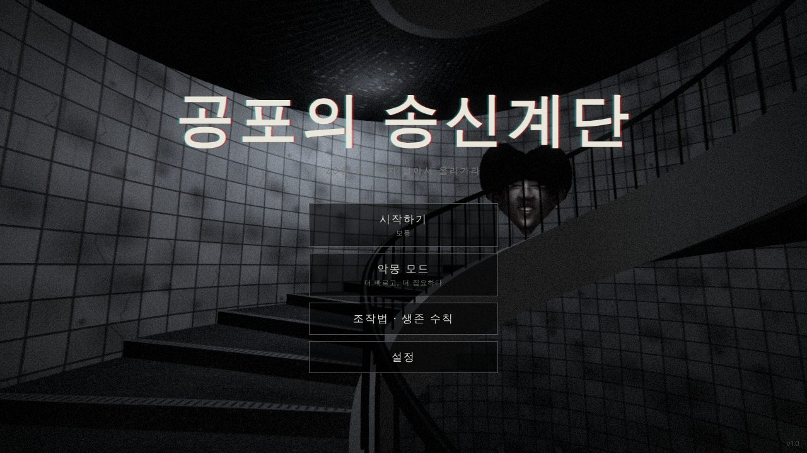
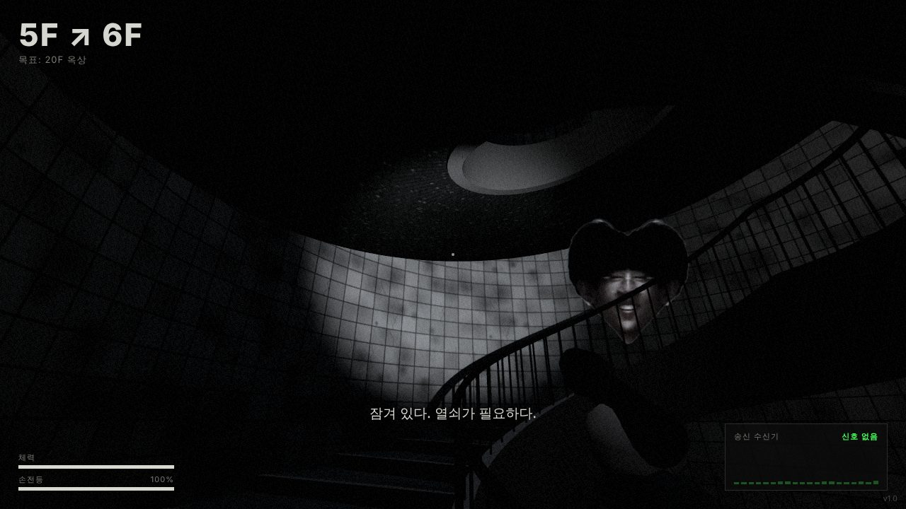
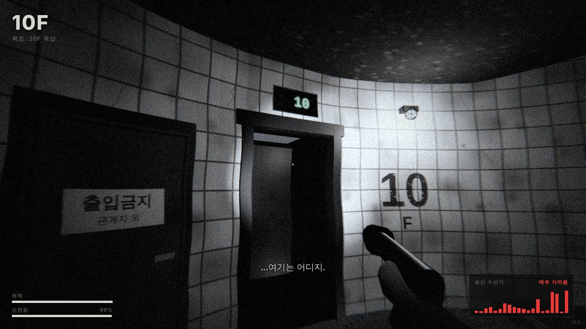

# 공포의 송신계단



끝없이 이어지는 나선형 계단을 1인칭으로 올라 **20층 옥상**까지 탈출하는 3D 추격형 공포 게임입니다.
계단과 엘리베이터를 오가며 당신을 쫓는 존재, **송신**을 피해야 합니다.

원작 `reference/Stalker.html`(2D 진행 바 게임)의 아이디어를 3D로 재구성했습니다.

## 실행 방법

| 방법 | 설명 |
|---|---|
| 바로 실행 | `dist/index.html` 을 데스크톱 브라우저(Chrome / Edge / Firefox)로 엽니다. 파일 하나에 코드·이미지가 모두 들어 있어 서버가 필요 없습니다. |
| 개발 모드 | `npm install` → `npm run dev` → <http://localhost:5173> (저장하면 자동 재빌드) |
| 빌드 | `npm run build` → `dist/index.html` 생성 |

PC(키보드 + 마우스) 전용입니다. 헤드폰 착용을 권장합니다 (입체 음향).

## 조작법

| 키 | 동작 |
|---|---|
| `W` `A` `S` `D` | 앞 · 왼쪽 · 뒤 · 오른쪽 이동 (보는 방향 기준) |
| 마우스 | 시점 회전 (화면 클릭 시 마우스 잠금) |
| `Shift` | 달리기 (체력 소모) |
| `C` / `Ctrl` | 웅크리기 (조용히 이동) |
| `F` | 손전등 켜기/끄기 |
| `E` | 줍기 · 쪽지 읽기 · 문 열기 |
| `Esc` / `P` | 일시정지 |

설정에서 마우스 감도, Y축 반전, 음량, 그래픽 품질, 음성 연출(브라우저 TTS)을 바꿀 수 있습니다.

## 게임 규칙

- **엘리베이터 표시기**: 모든 층의 표시기가 송신의 위치를 보여줍니다. 층수가 보이면 송신은 엘리베이터 안, `Err`가 보이면 계단 어딘가에 있습니다. 가끔 숫자가 뒤죽박죽(글리치)이 됩니다.
- **송신 수신기**(오른쪽 아래): 송신이 가까울수록 막대가 요동치고 지직거립니다.
- **청각과 시각**: 달리면 발소리가 멀리 퍼지고, 손전등을 켜 두면 멀리서도 눈에 띕니다. 웅크리면 조용히 지나갈 수 있습니다.
- **추격**: 송신은 걷는 속도보다 빠르고 달리는 속도보다 느립니다. 층이 높아질수록 빨라집니다. 잠시 따돌리거나 버티면 사라집니다.
- **숨기 페널티**: 한 층에 너무 오래(보통 45초 / 악몽 30초) 머물면 조명이 깜빡이고, 곧 송신이 엘리베이터를 타고 그 층으로 찾아옵니다.
- **넘어짐**: 5층 이상에서 계단을 오래 달리면 넘어질 수 있습니다. 큰 소리가 납니다.
- **옥상 열쇠**: 13~17층 계단참 어딘가에 있습니다. 줍는 순간 송신이 알아챕니다.
- **엘리베이터 버튼**: …누르지 않는 것이 좋습니다.
- 계단참에서 배터리와 쪽지(세계관 단서)를 찾을 수 있습니다.

난이도는 **보통**과 **악몽**(더 빠르고, 더 오래 쫓고, 더 잘 듣고, 이벤트가 잦음) 두 가지입니다.

## 공포 연출



- 맞은편 난간 너머 위층에서 송신이 내려다보다가, 눈이 마주치면 사라짐
- 정전: 모든 불이 꺼진 순간 바로 앞 계단에 서 있는 형체
- 아무도 없는 층에서 엘리베이터가 "띵" 하고 열림
- 위아래 층의 발소리, 귓가 속삭임, 멀리서 들리는 웃음
- 층 번호 표시가 순간 다른 글자로 바뀜
- 근접 시 화면 흔들림, 붉은 경보, 색수차, 글리치, 심장 박동, 거친 숨소리
- 잡히면 화면을 가득 채우는 점프스케어
- 탈출 후에도…



## 원작에서 가져온 아이디어와 개선점

| 원작 (`Stalker.html`) | 이 게임 |
|---|---|
| 버튼을 누르고 있으면 진행 바가 차서 한 층씩 오름 | 실제 3D 나선 계단을 WASD로 이동 |
| 스토커가 엘리베이터 ↔ 계단을 번갈아 이용 | 송신이 계단을 배회하고, 엘리베이터를 타고, 문이 열리며 등장 |
| 엘리베이터 층 표시 / 계단이면 `Err` | 모든 층의 엘리베이터 표시기에 그대로 구현 |
| 엘리베이터 출발 시 30% 확률 글리치 | 동일 (표시기 숫자가 무작위로 바뀜) |
| 45초 숨기 페널티 → FOUND YOU | 동일. 원작에서는 추격자가 플레이어를 잡지 못하던 버그를 고쳐 실제로 찾아옴 |
| 5층 이상, 오래 오르면 20% 확률로 넘어짐 | 계단을 오래 달리면 넘어짐 (소음 발생) |
| synth meter (근접 막대) | 송신 수신기 HUD + 지직거리는 잡음 |
| 화면 흔들림 / 빨간 오버레이 | 거리 기반 흔들림, 붉은 경보, 후처리 효과 |
| `dist < 0.001` 충돌 판정 (프레임에 따라 통과됨) | 3D 거리 기반 판정으로 프레임 속도와 무관 |
| Pause 키 5번 → 디버그 층 이동 | 동일하게 유지 |

## 프로젝트 구조

```
index.html          HTML/CSS (HUD, 메뉴) — 빌드 시 스크립트가 인라인됨
src/
  main.js           게임 루프, 상태 전환, 상호작용, 아이템
  config.js         계단 수학(나선 좌표), 난이도
  world.js          나선 계단 타워 생성 (계단, 난간, 벽, 엘리베이터, 문, 조명)
  player.js         1인칭 이동, 스태미나, 손전등, 넘어짐
  stalker.js        송신 AI (엘리베이터/배회/추격/사냥/소멸)
  director.js       공포 이벤트, 숨기 페널티, 조명 깜빡임
  audio.js          Web Audio 절차적 사운드 (오디오 파일 없음)
  post.js           흑백 필름 톤 후처리 셰이더
  textures.js       캔버스 절차적 텍스처
  hud.js            HUD / 화면
assets/songsin.png  송신 스프라이트 (배경 제거본)
assets/src/         원본 이미지 (송신 원본, 계단 참고 이미지)
tools/build.mjs     esbuild 단일 파일 빌드
tools/cutout.py     송신 이미지 배경 제거 스크립트
reference/          원작 HTML
```

사용 기술: [three.js](https://threejs.org/) 0.170, esbuild. 모든 소리와 텍스처는 코드로 생성합니다.
